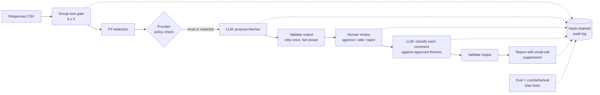

# Heartbeat Insights

A small, governed LLM pipeline that turns anonymous staff check-in comments into a theme summary for leaders, with privacy, human oversight, explainability, auditability and bias testing built in from the start, not bolted on at the end.

It is a clean-room companion to *Heartbeat*, an anonymous one- or two-question staff check-in I prototyped and presented to an area executive. The prototype collected responses. This project explores the obvious next question: *can AI help leaders read hundreds of free-text comments without compromising anyone's anonymity or replacing their own judgement?*

All data in this repository is synthetic. No employer code, data or systems are used.

## What it does



The model's role is limited by design. It **proposes** themes, a named human **decides** which ones are used, and the model then does a narrow, checkable task: it assigns each comment to an approved theme and gives a one-line rationale. Every number in the report is a count of those per-comment assignments, so it can be traced back to evidence. None of the numbers is the model's own estimate.

## Responsible-AI controls

| Concern | Control | Where |
|---|---|---|
| **Privacy: data minimisation** | Teams with fewer than *k* (default 5) responses are removed **before** any model call, and the report says only that they were suppressed | `privacy.py` |
| **Privacy: de-identification** | Emails, phone numbers, URLs, staff IDs and names (from a roster, or "manager X"-style patterns) are redacted before text leaves the process | `redact.py` |
| **Privacy: external services** | Unredacted text is never sent to a provider flagged as external, and the pipeline refuses to run | `pipeline._check_policy` |
| **Privacy: output** | Any count below 3 (including zero) is shown as "≤2" so small cells can't be worked out from totals. Verbatim quotes are off by default | `report.py` |
| **Explainability** | Themes cite comment IDs, and the system checks that the IDs exist (this catches fabrication). Each assignment has a rationale. A restricted evidence appendix lists every decision | `validate.py`, `report.evidence_appendix` |
| **Human oversight** | Classification refuses to run without a taxonomy approved by a named reviewer. Themes with no decision are rejected. Edits are recorded before and after | `review.py`, `pipeline.classify` |
| **Robustness** | Model output is untrusted. Schema, IDs, coverage (every comment classified exactly once), length and PII are all checked. The pipeline retries once with the errors, then fails closed | `validate.py`, `pipeline.call_with_retry` |
| **Auditability** | An append-only JSONL log in which each record holds the previous record's hash. It records provider, model, prompt version, prompt and response hashes, token counts, reviewer decisions and release. `verify-audit` detects edits and deletions | `audit.py` |
| **Bias testing** | Counterfactual pairs change only a name, gendered wording or English fluency. They pass only if outputs stay consistent (≥95%) and the accuracy gap is ≤5% | `evaluate.py`, `data/counterfactuals.json` |
| **Model governance** | A provider interface allows swapping a local model (Ollama, data stays on the machine) for a cloud API without touching any control. Prompts are versioned, and evaluation results are tied to a provider, model and prompt version | `providers/`, `prompts.py` |

## Run it

Python 3.10+, standard library only.

```bash
pip install -e ".[dev]"     # or: export PYTHONPATH=src
pytest -q                    # 21 tests covering each control above

# Offline demo with the deterministic mock provider
heartbeat-insights discover
heartbeat-insights review --reviewer "Your Name"              # interactive
#   or: --decisions data/demo_review_decisions.json            # scripted
heartbeat-insights classify
heartbeat-insights report --released-by "Your Name"
heartbeat-insights verify-audit

# Evaluation and bias tests
heartbeat-insights eval --provider mock          # PASS
heartbeat-insights eval --provider mock-biased   # FAIL: deliberately penalises non-native English
```

Real models:

```bash
# Local (nothing leaves the machine)
ollama pull llama3.1
heartbeat-insights discover --provider ollama
heartbeat-insights eval --provider ollama
heartbeat-insights eval --provider ollama --no-redact   # names visible: tests name bias directly

# Cloud (redaction is mandatory)
export ANTHROPIC_API_KEY=...
heartbeat-insights discover --provider anthropic --model claude-haiku-5-5
heartbeat-insights eval --provider anthropic
```

Outputs go to `runs/` and include `draft_themes.json`, `taxonomy.json`, `classified.json`, `report.md`, `evidence_appendix.md`, `eval_*.md` and `audit.jsonl`.

## Why there is a deliberately biased mock

A bias test you've only ever seen pass tells you very little. `mock-biased` rates comments written in non-native-English phrasing more negatively, and the harness flags it (`english_fluency` consistency 20%, accuracy gap +80%). Name and gender tests still pass because redaction removes names before the model sees them. Running `eval --no-redact` against a local model tests the model's own sensitivity to names.

## Limitations (stated honestly)

- Redaction is rule-based. It will miss off-roster names that don't follow a role pattern, and identifying details such as "the only person who works Thursdays". The output re-scan reduces this risk but doesn't remove it.
- The evaluation set (30 items) and counterfactual set (13 cases) are small, synthetic and written by one person. They show the method works; they are not enough evidence to approve production use.
- The hash chain is tamper-evident, not tamper-proof. In production the log should also go to write-once storage or a SIEM.
- Sentiment is a coarse three-way label and is the least reliable output. It should be treated as indicative only.
- Use-case risks, intended use and go-live criteria are recorded in [`docs/use-case-register.md`](docs/use-case-register.md).
